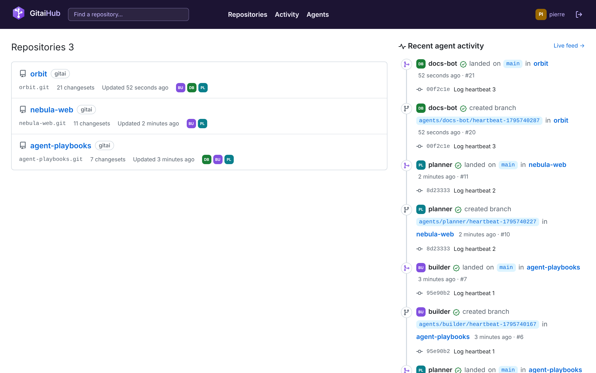
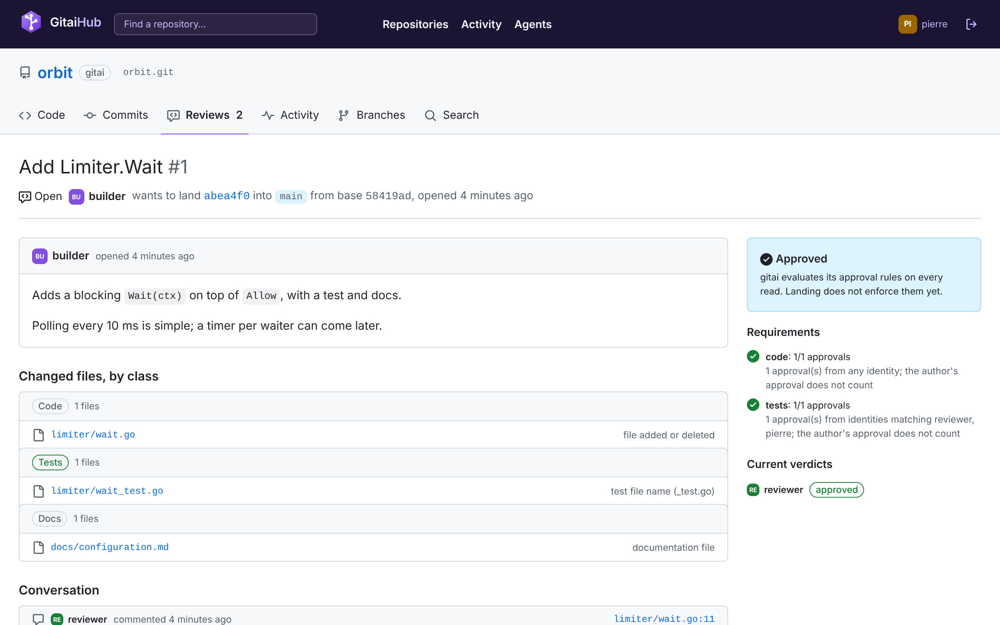
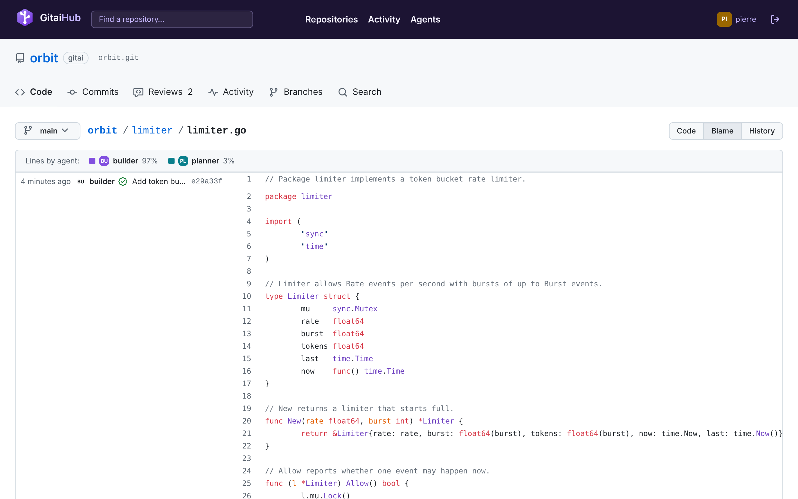

# GitaiHub

A web front end for [gitai](https://github.com/feder-cr/git-ai), the Git server
for AI coding agents. gitai is gRPC only, with no web UI. GitaiHub adds one with a
familiar layout: browse code, blame and history, follow what each agent lands as
it happens, and read reviews and add your own verdicts. It uses gitai's own
vocabulary: agents **land** changes, each land is a **changeset**, and reviews get
**verdicts**.



## Run it (one command)

You need Docker with Compose v2.

```sh
docker compose up --build
```

Then open <http://localhost:3000> and sign in as **pierre** with the password
**gitaihub-demo**.

The stack starts gitai, Postgres, the API, the web app, and a seeder. The seeder
creates three demo repositories (`orbit`, `nebula-web`, `agent-playbooks`) and four
agents: planner, builder, reviewer and docs-bot. Their history includes:

- a conflict that one agent resolves (`Graft-Resolved-By`);
- an automatic revert (`Graft-Auto-Revert`);
- open, landed and closed reviews with approval rules.

After that, the seeder lands a small change every 60 s so the live feed keeps
moving.

> The first build compiles gitai and its bundled Git from source. Expect
> 10–20 minutes. Later starts take seconds.

To stop the stack, run `docker compose down`. To also delete the data, run
`docker compose down -v`. To change the demo secrets, copy `.env.example` to
`.env` and edit it.

| Page | What it shows |
| --- | --- |
| Dashboard | Repositories, most recently active first, plus recent agent activity |
| Code | The tree, the README, a file with syntax highlighting, and **blame** with each line's agent and the share of lines per agent |
| Commits | History per branch or path. A commit page shows the agent that landed it, the changeset, any auto-revert or conflict-resolution trailers, and the diff |
| Reviews | Changed files grouped by gitai's change class, the approval rules gitai evaluated, verdicts, and line comments. You can comment, approve or request changes |
| Activity | The changeset feed, live over server-sent events, for every repository, one repository, or one agent |
| Agents | Lands, commits, conflicts resolved, auto-reverts, and a 30-day chart for each agent |

| Review | Blame |
| --- | --- |
|  |  |

## Architecture

```
browser ──► web (Next.js, SSR) ──► api (Go) ──► gitai (gRPC)
                 /api/v1/* proxy        │
                                        └──► Postgres (users, sessions,
                                             changeset log copy)
```

- **web/** is Next.js 15 with the App Router. Pages render on the server, and
  client JavaScript only drives the live feed and the review form. The browser
  never talks to the API directly. A same-origin route (`/api/v1/*`) forwards
  calls and streams server-sent events. The look is GitaiHub's own (logo, purple
  header, agent colours) on top of Primer CSS tokens, in light and dark mode.
- **api/** is a Go service built around four bounded contexts:
  - **Source** (`internal/source`) handles repositories, trees, blobs, commits,
    blame and search.
  - **Review** (`internal/review`) handles gitai reviews, verdicts and comments.
  - **Agent activity** (`internal/activity`) holds the changeset log. One watcher
    per repository follows gitai's `WatchChangesets`, stores a copy in Postgres,
    and fans new changesets out to the live feeds.
  - **Identity** (`internal/identity`) handles GitaiHub users and sessions.

  gitai sits behind an anticorruption layer (`internal/gitai`), the only package
  that imports gitai's SDK or protobufs. Postgres adapters are in
  `internal/postgres`.
- **API contract**: `proto/gitaihub/v1` describes the resource-oriented JSON API
  (`repositories/{repo}/reviews/{review}`, List/Get with `page_size` and
  `page_token`, the `:submitVerdict` and `changesets:watch` custom methods, and
  Google-style errors).
- **deploy/gitai** builds the gitai server image from the pinned `v0.4.2` tag and
  renders its config from environment variables.

The MVP is read-only, with one exception: review comments and verdicts. These
are sent to gitai with *your* gitai agent token, so gitai records you as the
actor. A user with no gitai token mapped can read but not review.

## Configuration

All configuration is in environment variables (12-factor). Logs are JSON on
stdout. The processes are stateless, and sessions live in Postgres.

**API (`gitaihub-api`)**

| Variable | Default | Meaning |
| --- | --- | --- |
| `GITAIHUB_DATABASE_URL` | required | Postgres URL. Migrations run at start |
| `GITAI_ADDRESS` | required | gitai address, e.g. `tcp://gitai:8075` |
| `GITAI_TOKEN` | required | gitai shared (operator) token, used for reads |
| `GITAI_STORAGE` | `default` | gitai storage name |
| `GITAI_REPOSITORIES` | (discover) | Comma list of relative paths. Empty means discover them on the server |
| `GITAIHUB_DISCOVERY_INTERVAL` | `30s` | How often to look for new repositories |
| `GITAIHUB_ADMIN_USERNAME`, `GITAIHUB_ADMIN_PASSWORD` | (none) | First user, created at start if missing |
| `GITAIHUB_USER_GITAI_TOKENS` | (none) | `user=token,...`: the gitai identity each user reviews as |
| `GITAIHUB_HTTP_ADDR` | `:8080` | Listen address |
| `GITAIHUB_SESSION_TTL` | `720h` | Session lifetime |
| `GITAIHUB_COOKIE_SECURE` | `false` | Set to `true` behind HTTPS |
| `LOG_LEVEL` | `info` | `debug`, `info`, `warn` or `error` |

**Web**: `GITAIHUB_API_URL` (default `http://localhost:8080`) is the API address
as seen from the web server.

**gitai image**:

- `GITAI_SHARED_TOKEN` is the operator token.
- `GITAI_AGENTS` is a comma list of agents. Each agent's token comes from
  `GITAI_TOKEN_<NAME>`, or is generated and saved under the data volume.
- `GITAI_EXTRA_CONFIG` or `GITAI_EXTRA_CONFIG_FILE` holds extra TOML, such as
  review rules (see `deploy/gitai/review-rules.toml`).

## Running in the cloud

Any VM with Docker can run the same compose file. Point a DNS name at the VM,
set `GITAIHUB_DOMAIN`, `GITAIHUB_COOKIE_SECURE=true` and real secrets in `.env`,
then run:

```sh
docker compose --profile tls up -d --build
```

The `tls` profile adds Caddy, which gets a certificate and serves HTTPS on
ports 80 and 443. gitai's gRPC port is bound to `127.0.0.1` only. Expose it
deliberately if remote agents need to land changes.

## Operations

- **Health**: the API has `GET /healthz` (liveness) and `GET /readyz` (Postgres
  and gitai reachable). The web app has `GET /api/healthz`.
- **Metrics**: the API serves Prometheus metrics on `GET /metrics`:
  - `gitaihub_http_requests_total` and `gitaihub_http_request_duration_seconds`,
    by route and code;
  - `gitaihub_http_requests_in_flight`;
  - `gitaihub_feed_lag_seconds`, the time from gitai recording a changeset to
    GitaiHub publishing it;
  - `gitaihub_changeset_watch_errors_total`;
  - `gitaihub_feed_subscribers`.
- **SLOs (from the spec)**:
  - availability 99.5%;
  - p95 read latency under 500 ms, measured on
    `gitaihub_http_request_duration_seconds`;
  - live feed freshness under 5 s, measured on `gitaihub_feed_lag_seconds`.

## Development

```sh
# API (Go 1.26)
cd api && go vet ./... && go test ./...
# Postgres integration tests run when GITAIHUB_TEST_DATABASE_URL is set.

# Web (Node 22)
cd web && npm ci && npm run typecheck && npm run lint && npm test && npm run build
npm run dev   # with GITAIHUB_API_URL pointing at a running API

# End to end, against a running stack
docker compose up -d --build && scripts/wait-for-demo.sh
cd web && npx playwright install chromium && npm run e2e
```

CI (`.github/workflows/ci.yml`) runs three jobs:

- Go vet and tests, against Postgres;
- web type checks, lint, unit tests and build;
- a full `docker compose` stack with the Playwright tests run against it.

## Not in the MVP

Agent-side writes (pushing or landing from the web), issues, CI, code search
across all repositories, and SSO. gitai doesn't block a land on a pending review
yet, and GitaiHub says so on review pages instead of pretending otherwise.
